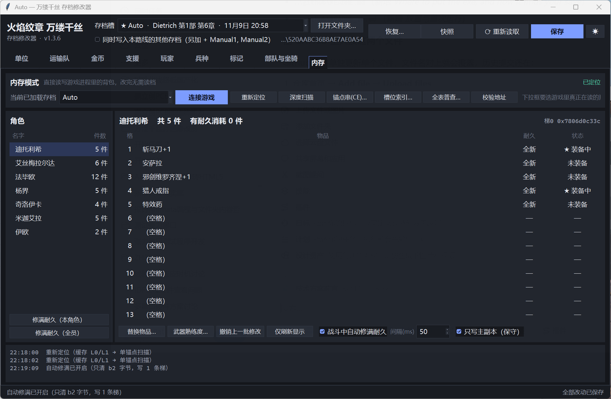
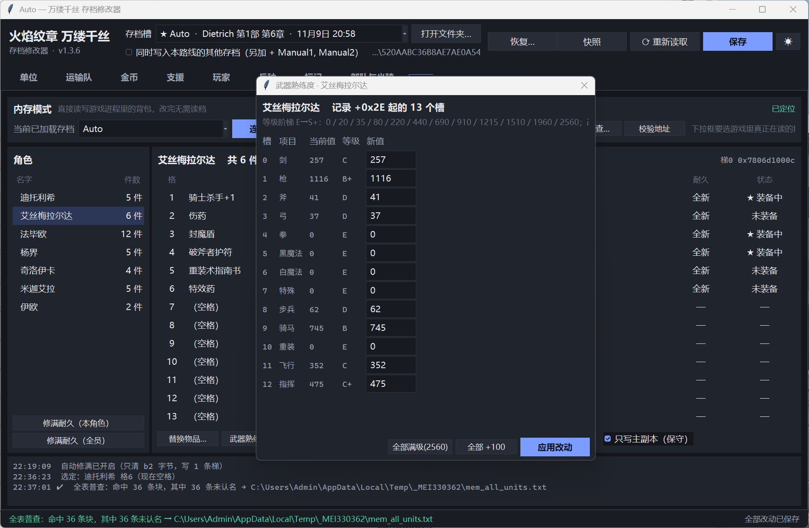
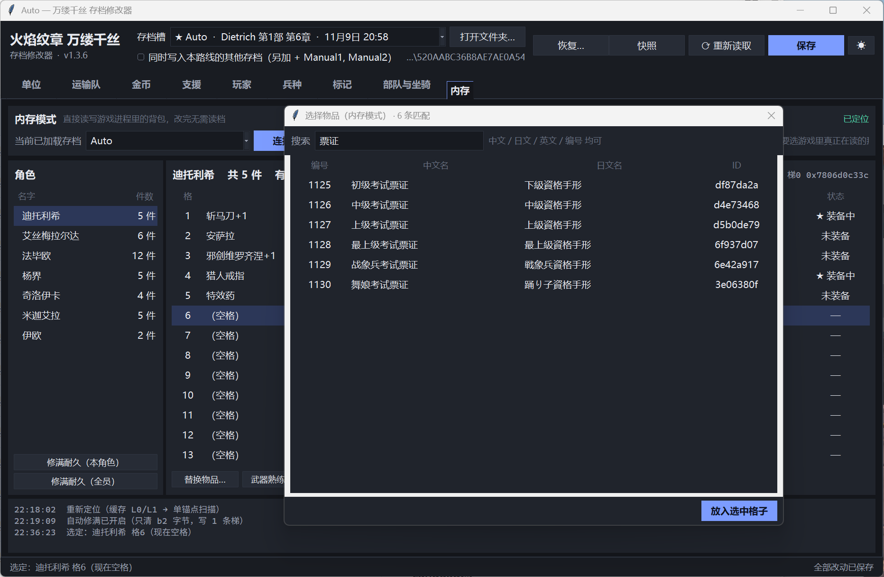

# Fortune's Weave Save Editor · Chinese Edition

**English** | [简体中文](README_zh.md)

A save editor for **Fire Emblem: Fortune's Weave** (Switch / Eden emulator /
recompiled PC build), with a **fully Chinese UI** and a **live memory mode** that
edits the running game — no save reload needed.

Forked from [**Antiadvocate/fefw-editor**](https://github.com/Antiadvocate/fefw-editor)
(upstream, English). The save-editing engine is upstream's work; what this fork
adds is the Chinese localization, the memory mode, and a pile of measurement
work on the game's runtime structures.

> **Unofficial and reverse-engineered.** Close the game before writing a save and
> keep your own backups. The editor also keeps the untouched original next to
> each slot as `<slot>.bak`. Version **1.3.6**.

---

## Screenshots

**Memory mode** — reads the running game directly: roster and item counts on the left,
the selected unit's 30 slots on the right. Writes go into process memory, so the change
is visible immediately.



**Weapon masteries** — 13 slots, each with its own threshold ladder
(E→S+: 0 / 20 / 35 / 80 / 220 / 440 / 690 / 910 / 1215 / 1510 / 1960 / 2560).
Per-slot edits, "+100 to all", or "fill all (2560)".



**Item picker** — search by Chinese / Japanese / English name or internal id. Exam
tickets, which only ever live in the material pouch, can be added from here and nowhere
else.



---

## What makes this fork different

| | Upstream | This fork |
|---|---|---|
| UI language | English | **Chinese** — every page, tab, column, dialog, status line |
| Editing a save file | ✅ | ✅ (unchanged engine) |
| Editing the **running game's** inventory, durability, masteries | ✖ | ✅ **memory mode** (9th tab) |
| Multi-save-slot builds | — | ✅ tested on a modified build that writes `Auto`, `Manual1`–`Manual10`, `Chapter_*` slots |

### Multi-save-slot support

The original game writes one autosave slot. The modified build used here keeps up
to ten manual slots plus `Auto` inside the same save folder
(`…/save/account/<account id>/000/`). Both modes read that folder as-is:

* **Save mode** — pick any slot in the file list (`Auto`, `Manual1` … `Manual10`,
  `Chapter_*`); edits are written to that slot only, `.bak` kept beside it.
* **Memory mode** — the slot dropdown is filled from the same folder; choose the
  slot the game is *actually* reading right now (the panel shows which one it
  matched).

Nothing assumes a single-file save, so nothing breaks when you keep ten copies.

---

## Modes

### 1. Save mode (offline, edits the file)

Units, arts & skills, inventory, class, convoy (materials included), gold,
player/difficulty/flags, class lists, weapon masteries, supports, mounts,
named flags, plus undo and whole-folder snapshots.

The page-by-page reference is upstream's — see
[upstream's release page](https://github.com/Antiadvocate/fefw-editor/releases/latest)
for screenshots and the full feature list. Chinese page names are a one-to-one
map of upstream's, so that documentation still applies.

### 2. Memory mode (live, edits the running process)

Tab 9 of the main editor. Works while the game is running; changes take effect
immediately, and **do not survive a reload** (save in-game to make them stick).

**Quick start**

1. Start the game and load a save (get to in-game play).
2. Open the editor (`FEFW Save Editor 中文版.exe`, or `python editor.py`), press
   **打开文件夹** and choose the save folder (the slot list is read from it).
3. Go to the **内存** tab, pick the slot the game currently has loaded.
4. Press **定位**. Status turns green when the anchor is found:
   - `已定位（L0 缓存直接命中）` — same process as last time, ~2 ms
   - `已定位（L1 区域指纹重定位）` — after a game restart, ~0.5 s
   - `全量扫描` — cache useless, minutes (rarely needed)
5. Left: unit list. Right: 30 inventory slots of that unit.

**What you can do there**

| Action | What it writes |
|---|---|
| **修满耐久（本角色 / 全员）** | only the "durability spent" byte `b2` → 0. Item id untouched |
| **替换物品…** | whole 8-byte slot: new id + `b2=0` + `b3=0`; written as brand-new / unequipped |
| **战斗中自动修满耐久** | same single byte, every 50 ms (20–1000 ms configurable) |
| **物品目录搜索** | Chinese / Japanese / English / internal id; `H_`-prefixed rows are the duplicate entries the game keeps internally |

Inventory slot layout (measured, not guessed): 30 slots × 8 bytes per unit,
stride `0x8B0`; `b0b1` internal item id (little-endian u16, 0 = empty), `b2`
durability spent, `b3` equipped flag, `b5..b7` always zero (used as a structural
check).

**Things that surprised us (worth knowing before you poke it)**

* The same inventory exists as **two copies (A/B)** in memory; the game keeps them
*in sync*, so writing one copy is usually enough. The panel can write both.
* Slot arrays live in **`MEM_MAPPED`**, not `MEM_PRIVATE`, and slot starts are
  **4-byte** aligned — a scanner that skips mapped regions or assumes 8-byte
  alignment will find nothing.
* Some items **never appear in the save at all** — the qualification certificates
  used for class exams sit in the materials bag and are only reachable through the
  memory side. The item picker searches the internal id table, which is why you can
  add them here but not in save mode.
* Green status is not a guarantee forever: if the game rewrites its inventory
  (using a skill book, picking up loot, changing party), the anchor can go stale.
  Press **重新定位**; or save once in-game and re-locate against the new save.

**Memory mode caveats**

* **Do not use 撤销上一批修改** on the memory tab. It writes back the snapshot,
  and after a batch of mastery edits it has crashed the game (the editor lost its
  anchor mid-write). To undo, just type the old number back in.
* Write permission parity: if the game runs elevated, run the editor elevated too.
* 30 slots exist, but the unit screen only shows 6 held + 12 class attacks +
  6 attack spells + 6 support spells — filling all 30 does not put more in hand.
* Classic mode permadeath: a fallen unit is **removed from the unit pool** when the
  battle ends. There is no flag or counter to resurrect; load an earlier save
  instead. That is why "阵亡" cannot be found anywhere in save mode.

---

## Where to put the exe, and how it finds your save

The exe is a single file and **starts from anywhere**, with two things worth knowing:

* The eight data json files and `物品代码对照表.csv` are **embedded inside the exe**, so
  nothing has to sit beside it. But the program does read/write these **next to the exe**:
  `editor_settings.json` (theme, last opened save folder, options), `money_sig.json`,
  and `icons\` (item / unit icons — missing icons only means no pictures, the features
  still work). So **do not put it in `C:\Program Files`** or any unwritable folder,
  otherwise settings cannot be saved and you re-pick the save folder every launch.
* **The save folder is discovered automatically**, in this order:

  1. Walk up to **five levels** from the exe's own directory looking for `fefw.ini`,
     and take its `[fs] save_dir` (default `save`) — the recompiled build's save root;
  2. `%APPDATA%\eden\nand\user\save` (Eden emulator);
  3. `~/.local/share/eden/nand/user/save`, `~/AppData/Roaming/eden/...`.

  A folder counts as a save when it contains an `Auto` file; both the recomp layout
  (`<root>/account/<id>/000/`) and the Eden layout
  (`<root>/<id>/04007EF01F8AE000/000/`) are recognised.

  So **unzipping the editor inside the recompiled game's directory** lets it find `save`
  by itself. Anywhere else is fine too: on first run click **Open folder** and pick
  `…\save\account\<id>\000` once — it is remembered in `editor_settings.json`.

---

## Building

Single-file Windows exe with PyInstaller (Python 3.12, `pyinstaller 6.12.0`),
`zstandard` is the only runtime dependency. Full reproducible steps, including the
three traps (data files **must** be embedded because the reader uses `_MEIPASS`;
`--add-data` needs absolute source paths when `--specpath` is elsewhere; written
files land next to the exe, not in the bundle) are in
**[打包说明.md](打包说明.md)**.

```powershell
# short version
pip install "zstandard>=0.21" "pyinstaller==6.12.0"
# then run the command block from 打包说明.md — it embeds 8 json + 物品代码对照表.csv
```

Running from source needs nothing else:

```powershell
python -m pip install -r requirements.txt
python editor.py                     # save editor (both modes, 9 tabs)
python mem_editor_gui.py             # standalone memory editor
```

---

## Data files

| File | Rows | Notes |
|---|---|---|
| `flag_names.json` | 51,586 | named variables (supports, unlocks, achievements) |
| `item_ids.json` | 2,908 | internal id → JP / EN / ZH name |
| `unit_ids.json` | 3,225 | person id → name |
| `skill_ids.json` | 2,876 | skill / art ids |
| `job_ids.json` | 342 | class ids |
| `supports.json`, `support_points.json` | 1, / 5 keys | support pairs, thresholds |
| `物品代码对照表.csv` | 2,908 | id ↔ internal id ↔ name, used by memory mode |

Names are extracted from the game's own message files (`romfs/Msg/.../*.msbt`).
Re-generating them needs an **unpacked romfs**, which is not shipped here:
`build_item_names.py`, `build_unit_names.py`, `build_skill_ids.py`,
`build_flag_names.py`, `build_zh_names.py` (see upstream README for arguments).
**1,701 rows of `物品代码对照表.csv` still have an empty Chinese name** and 786
rows are `H_` duplicates — those need a romfs to fill.

---

## Credits

* **Antiadvocate** — the original `fefw-editor`: save parsing, block table,
  unit pool, item/convoy/support/flags editing. This fork would not exist without
  that work. Upstream README kept at [docs/upstream-README.md](docs/upstream-README.md).
* **Doubao (豆包) AI** — the Chinese localization, the memory mode, and most of the
  runtime-structure measurements in [内存编辑器说明.md](内存编辑器说明.md) were built
  in a long collaborative session with Doubao. Sharing that session's results is the
  point of publishing this fork.
* Structural notes recovered by hand from live memory are documented with the
  exact bytes, so anyone can re-verify them.

## License / disclaimer

Upstream ships **no license file**, and neither does this fork — treat it as
personal-use / study material, and ask the upstream author before redistributing.
No warranty: editing saves or live memory can corrupt your progress. Keep backups.
