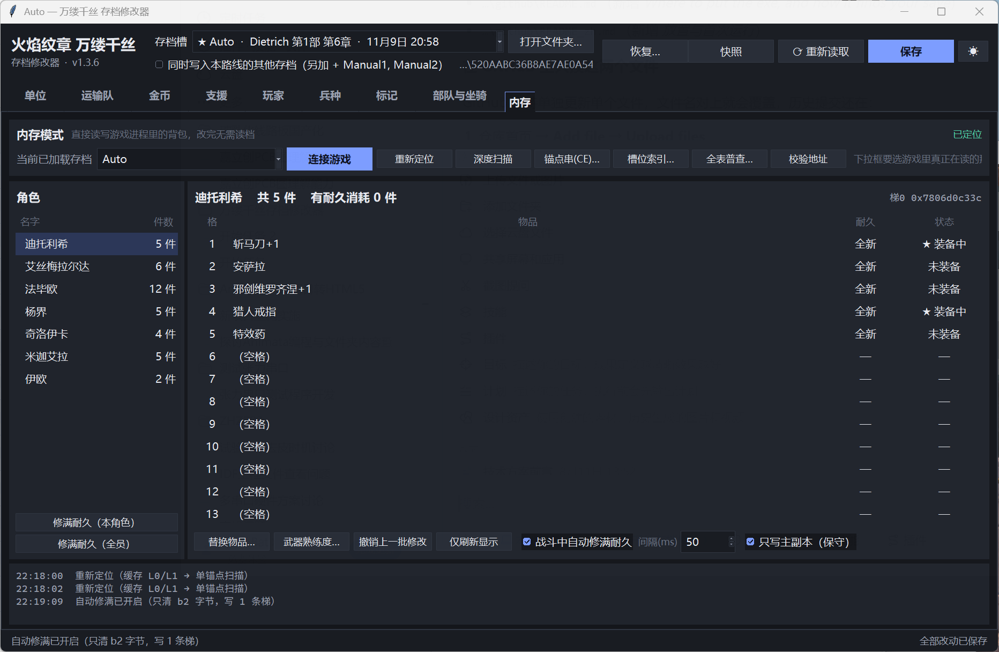
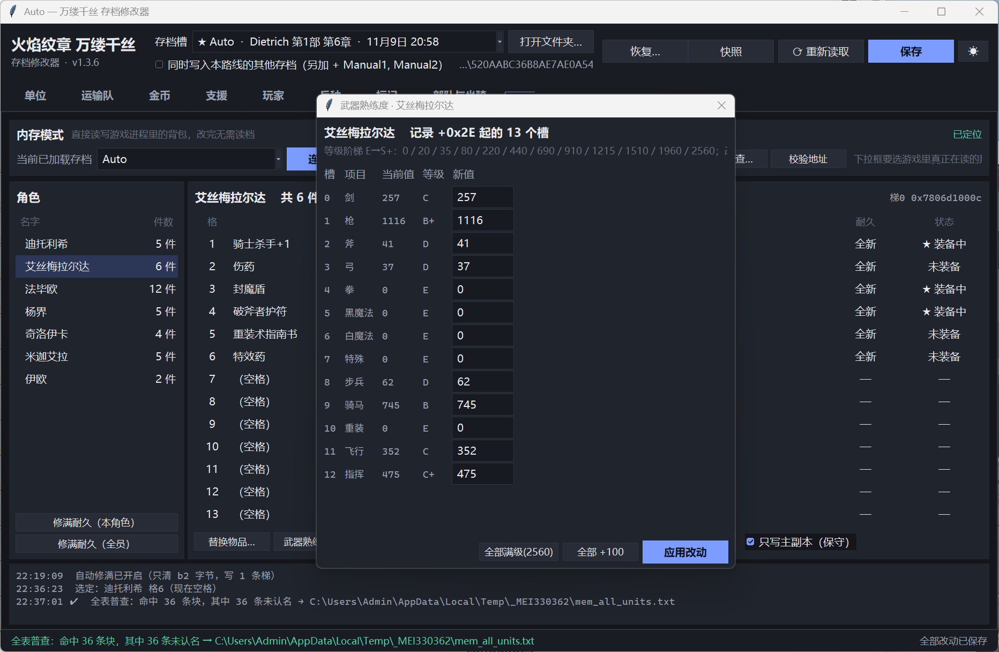
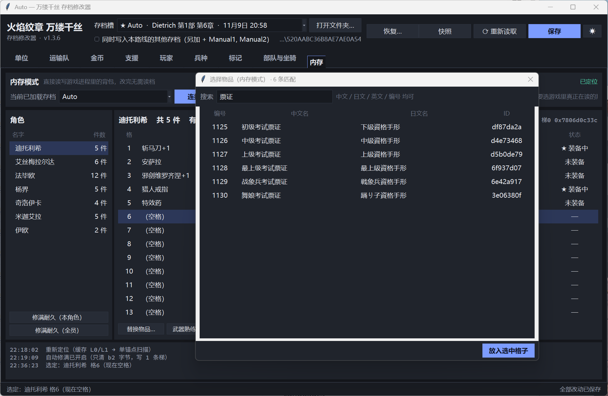

# 火焰纹章·万缕千丝 存档修改器 · 中文版

[English](README.md) | **简体中文**

**《火焰纹章·万缕千丝》**（Switch / Eden 模拟器 / 重编译 PC 版）的存档修改器。
界面**全中文**，另外加了一个**内存模式**：直接读写正在运行的游戏，改完不用读档。

基于上游 [**Antiadvocate/fefw-editor**](https://github.com/Antiadvocate/fefw-editor)（英文原版）。
存档读写引擎是上游的成果，这个分支做的是：中文本地化、内存模式，以及一批对游戏运行时结构的手工实测。

> **非官方、逆向所得。** 写存档前请先关掉游戏，并且自己留备份；修改器也会在每槽旁边留一份
> `<槽名>.bak` 原文件。当前版本 **1.3.6**。

---

## 界面

**内存模式**——直接读正在运行的游戏：左侧角色与其物品件数，右侧选中角色的 30 格明细，
写入的是进程内存，改完立刻生效。



**武器熟练度**——13 个槽位，每槽一条阈值阶梯（E→S+：0 / 20 / 35 / 80 / 220 / 440 / 690 /
910 / 1215 / 1510 / 1960 / 2560），可以逐槽填，也可以「全部 +100」或「全部满级(2560)」。



**物品目录**——中文 / 日文 / 英文 / 内部编号都能搜。考试票证这类只在材料袋里的东西，
只有内存侧能加。



---

## 这个分支与上游的区别

| | 上游 | 本分支 |
|---|---|---|
| 界面语言 | 英文 | **中文**（页面、页签、列名、弹窗、状态栏全部） |
| 改存档文件 | ✅ | ✅（引擎未改） |
| 改**运行中游戏**的背包 / 耐久 / 熟练度 | ✖ | ✅ **内存模式**（第 9 个页签） |
| 多存档槽的修改版 | — | ✅ 在「`Auto` + `Manual1`~`Manual10` + `Chapter_*`」的修改版上实测通过 |

### 多存档槽支持

原版游戏只有一个自动存档槽；这里用的修改版会在同一个账号目录
（`…/save/account/<账号 id>/000/`）里写入 `Auto` 和最多十份 `ManualN`。
两种模式都按目录原样读取：

* **存档模式** —— 文件列表里直接选槽（`Auto`、`Manual1`…`Manual10`、`Chapter_*`），
  改动只写进选中的那一份，原文件留 `.bak`。
* **内存模式** —— 槽位下拉框由同一个目录填充；选**游戏此刻真正在读的那一槽**
  即可（面板会显示匹配到哪一份）。

不需要把存档当成"只有一个文件"，所以留十份副本也不会出问题。

---

## 两种模式

### 一、存档模式（离线，改文件）

单位属性、战技与技能、背包、兵种、运输队（含材料）、金钱、玩家/难度/通关次数、
兵种表与武器熟练度、支援、坐骑/兵团、命名变量（flags），外加撤销和整目录快照。

每个页面的详细说明看上游的就行——中文页名与上游一一对应，截图和功能清单见
[上游发布页](https://github.com/Antiadvocate/fefw-editor/releases/latest)。

### 二、内存模式（在线，改进程）

主编辑器第 9 个页签。游戏开着就能用，改完**立刻在游戏里生效**；但改动**不落盘**，
要让改动留下来，得在游戏里自己存一次档。

**上手四步**

1. 启动游戏并**读进存档**（进到游戏内画面）。
2. 打开修改器（`FEFW Save Editor 中文版.exe`，或 `python editor.py`），点**打开文件夹**
   选中存档目录（槽位列表从目录里读）。
3. 切到**内存**页签，下拉里选游戏当前在读的那一槽。
4. 点**定位**。状态变绿即成功：

   - `已定位（L0 缓存直接命中）` —— 同一次游戏进程内，约 2 ms
   - `已定位（L1 区域指纹重定位）` —— 游戏重启后靠区域指纹找回，约 0.5 s
   - `全量扫描` —— 缓存彻底失效，需要扫几分钟（很少用）

5. 左侧角色列表，右侧该角色的 30 格背包明细。

**能做的事**

| 操作 | 实际写入 |
|---|---|
| **修满耐久（本角色 / 全员）** | 只把"已消耗耐久"字节 `b2` 写 0，物品编号不动 |
| **替换物品…** | 整格 8 字节：新编号 + `b2=0` + `b3=0`，写成**全新、未装备** |
| **战斗中自动修满耐久** | 同一个字节，每 50 ms 扫一遍（可调 20–1000 ms） |
| **物品目录搜索** | 支持中文 / 日文 / 英文 / 内部编号；`H_` 前缀是游戏内部保留的重复条目 |

背包结构（实测，非推断）：每单位 30 格 × 8 字节，单位之间间隔 `0x8B0`；
`b0b1` 物品内部编号（小端 u16，0 = 空格）、`b2` 已消耗耐久、`b3` 已装备标记、
`b5..b7` 恒为 0（当结构校验用）。

**几个反直觉但必须先知道的点**

* 同一份背包在内存里有 **A/B 两份副本**，游戏自己会同步，所以一般写一份就够，
  面板可以两份都写。
* 槽位数组在 **`MEM_MAPPED`** 映射区（不是 `MEM_PRIVATE`），而且格起始是
  **4 字节对齐**（不是 8 字节）。跳过映射区、或按 8 字节对齐去扫，永远搜不到。
* **有些物品根本不在存档里**：上级职业考试要用的票证放在材料袋，只能在内存侧
  找到。物品目录搜的是内部编号表，所以这类东西"内存模式能加、存档模式没有"。
* 状态绿了不等于永远有效：游戏改写背包（用掉技能书、捡到东西、换出战）之后锚点
  可能失效。点**重新定位**；或者在游戏里先存一次档，再按新存档重新定位。

**内存模式的坑**

* **不要用「撤销上一批修改」**。它会把快照写回去，而在批量改过熟练度之后按它，
  曾把游戏写崩（写入过程中锚点失效）。想反悔就直接把数字改回原值。
* 权限要对齐：游戏若以管理员启动，修改器也要以管理员启动。
* 30 格虽然能写，但人物界面只显示 6 格持有 + 12 格兵种攻击 + 6 格攻击魔法
  + 6 格辅助魔法，写满 30 格也不会都进持有栏。
* 经典模式的永久死亡：阵亡单位在**战斗结束时被从单位池里移除**，没有任何 flag
  或计数器可以复活，只能读回更早的存档——这也是存档模式里搜不到"阵亡"的原因。

---

## 放置与首次运行

exe 是单文件，**放哪都能启动**，但有两点值得知道：

* 8 个数据 json 和 `物品代码对照表.csv` 已经**嵌在 exe 内部**，不用另外拷到旁边；
  但程序会在 **exe 所在目录**写/读这些东西：`editor_settings.json`（主题、上次打开的
  存档目录等）、`money_sig.json`、`icons\`（物品/人物图标，缺了只是不显示图标，
  功能不受影响）。所以**别放在 `C:\Program Files` 这类没有写权限的目录**，
  否则设置存不下来、每次都要重新选存档。
* **存档目录是自动找的**，顺序如下：

  1. 从 exe 所在目录**逐级向上最多 5 级**找 `fefw.ini`，读其中的 `[fs] save_dir`
     （默认 `save`）——也就是重编译版游戏自己的存档根；
  2. `%APPDATA%\eden\nand\user\save`（Eden 模拟器）；
  3. `~/.local/share/eden/nand/user/save`、`~/AppData/Roaming/eden/...`。

  判定标准是"这个目录里有 `Auto` 文件"，重编译版的 `<root>/account/<账号>/000/`
  和 Eden 的 `<root>/<账号>/04007EF01F8AE000/000/` 两种布局都认。

  所以：**把修改器整个解压目录放进重编译版游戏目录里**，它自己就能认出 `save`；
  放在别处也没关系，首次启动点**打开文件夹**手动选一次
  `…\save\account\<账号>\000`，之后会记在 `editor_settings.json` 里，下次直接打开。

---

## 编译

单文件 Windows exe，PyInstaller + Python 3.12（`pyinstaller 6.12.0`），
运行期只依赖 `zstandard`。完整的可复现命令和三个坑写在
**[打包说明.md](打包说明.md)**：

* 数据 json **必须打进包**（读取走 `_MEIPASS`，只放 exe 旁边会启动即报错）；
* `--specpath` 换目录时，`--add-data` 的源路径要写**绝对路径**；
* 写出去的文件（设置、`money_sig.json`、`icons/`）落在 exe 旁边，不在包里。

```powershell
pip install "zstandard>=0.21" "pyinstaller==6.12.0"
# 然后照 打包说明.md 里的命令块执行（会嵌入 8 个 json + 物品代码对照表.csv）
```

直接跑源码则不需要别的：

```powershell
python -m pip install -r requirements.txt
python editor.py                     # 存档修改器（双模式，9 个页签）
python mem_editor_gui.py             # 独立的内存编辑器
```

---

## 数据文件

| 文件 | 条数 | 说明 |
|---|---|---|
| `flag_names.json` | 51,586 | 命名变量（支援、解锁、成就） |
| `item_ids.json` | 2,908 | 内部编号 → 日/英/中文名 |
| `unit_ids.json` | 3,225 | 人物 id → 名字 |
| `skill_ids.json` | 2,876 | 技能 / 战技 |
| `job_ids.json` | 342 | 兵种 |
| `supports.json`、`support_points.json` | 1 / 5 键 | 支援对、阈值 |
| `物品代码对照表.csv` | 2,908 | 编号 ↔ 内部编号 ↔ 名称，内存模式在用 |

名字全部来自游戏自己的消息文件（`romfs/Msg/.../*.msbt`）。要重新生成得有**解包好的
romfs**，本仓库不附带：`build_item_names.py`、`build_unit_names.py`、
`build_skill_ids.py`、`build_flag_names.py`、`build_zh_names.py`（参数见上游 README）。
**`物品代码对照表.csv` 里还有 1,701 行中文名为空、786 行是 `H_` 重复条目**，补齐同样需要 romfs。

---

## 致谢

* **Antiadvocate** —— 上游 `fefw-editor` 的作者：存档解析、块表、单位池、物品/运输队/
  支援/flags 编辑都是他的工作，没有这些就没有这个分支。上游 README 保留在
  [docs/upstream-README.md](docs/upstream-README.md)。
* **豆包（Doubao）AI** —— 中文本地化、内存模式，以及 [内存编辑器说明.md](内存编辑器说明.md) 里
  绝大多数运行时结构的实测，都是和豆包长时间协作做出来的。把这个协作过程的结果公开，
  正是本分支发布的意义。
* 从活内存里手工恢复出来的结构全部附了原始字节，任何人都能自己复核。

## 许可与免责

上游**没有** LICENSE 文件，本分支也没有——请当作个人使用 / 学习用途，二次分发前先联系上游作者。
不提供任何担保：改存档或改活内存都可能损坏进度，务必留备份。
