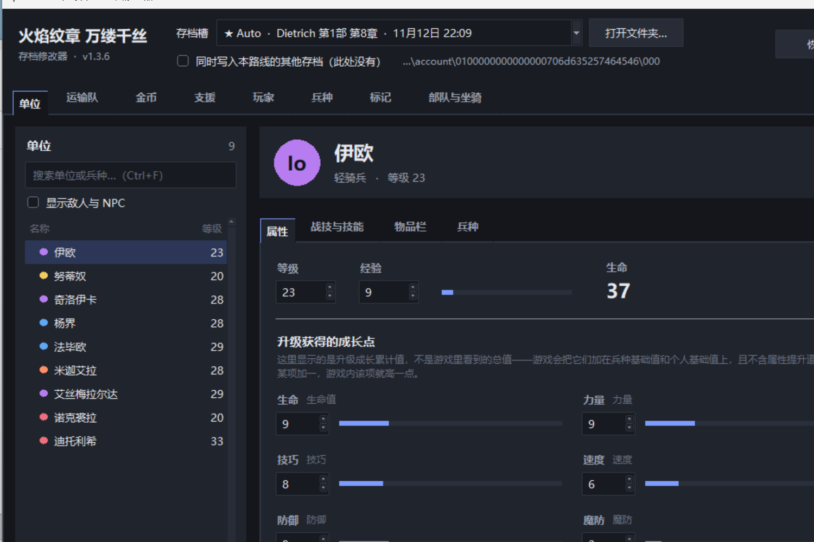
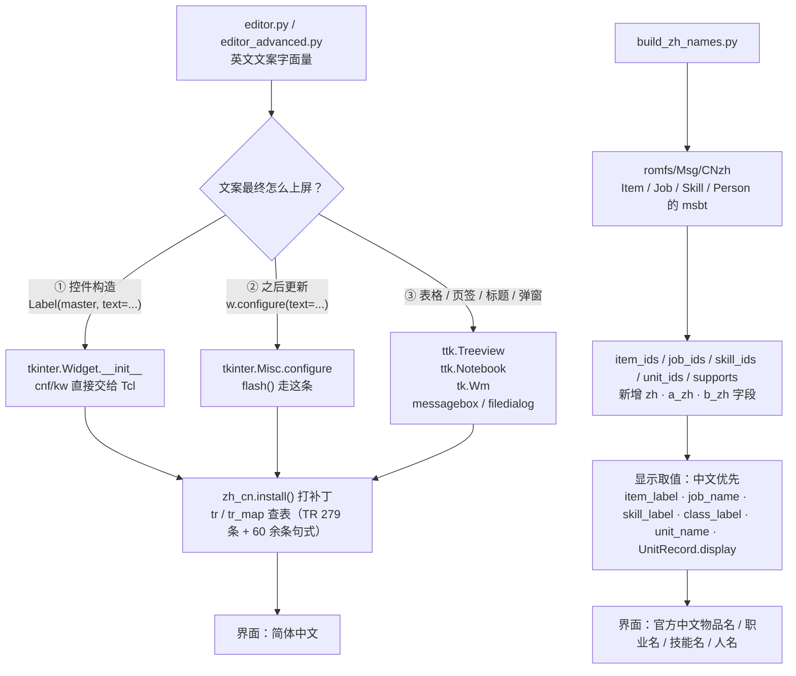
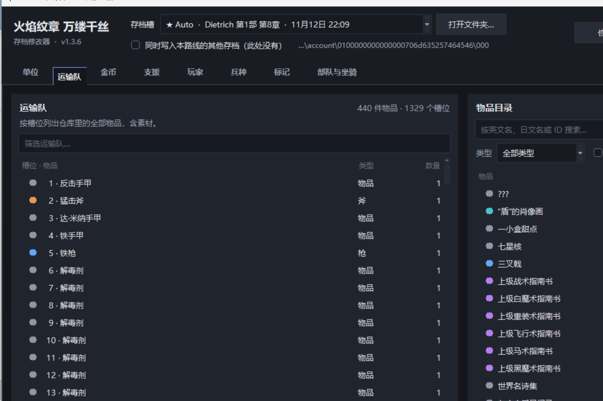
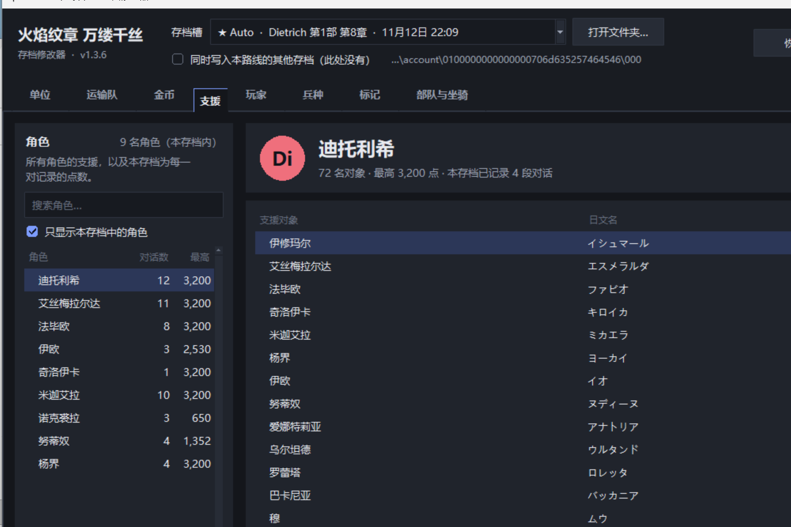
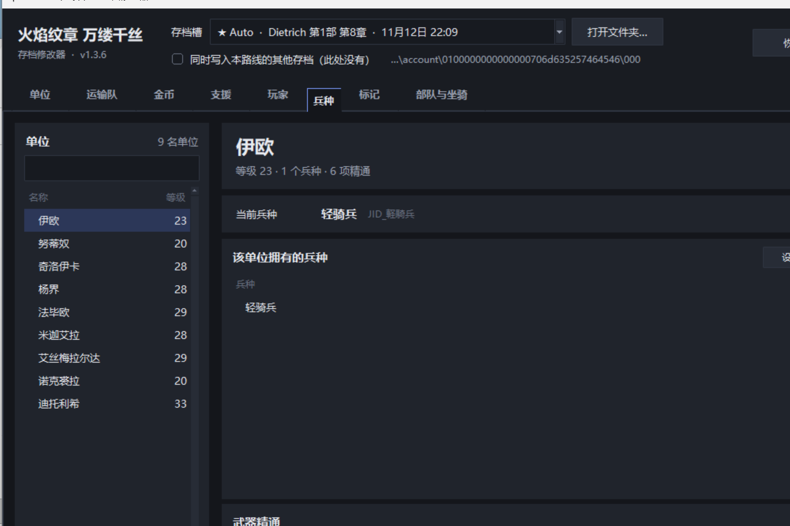
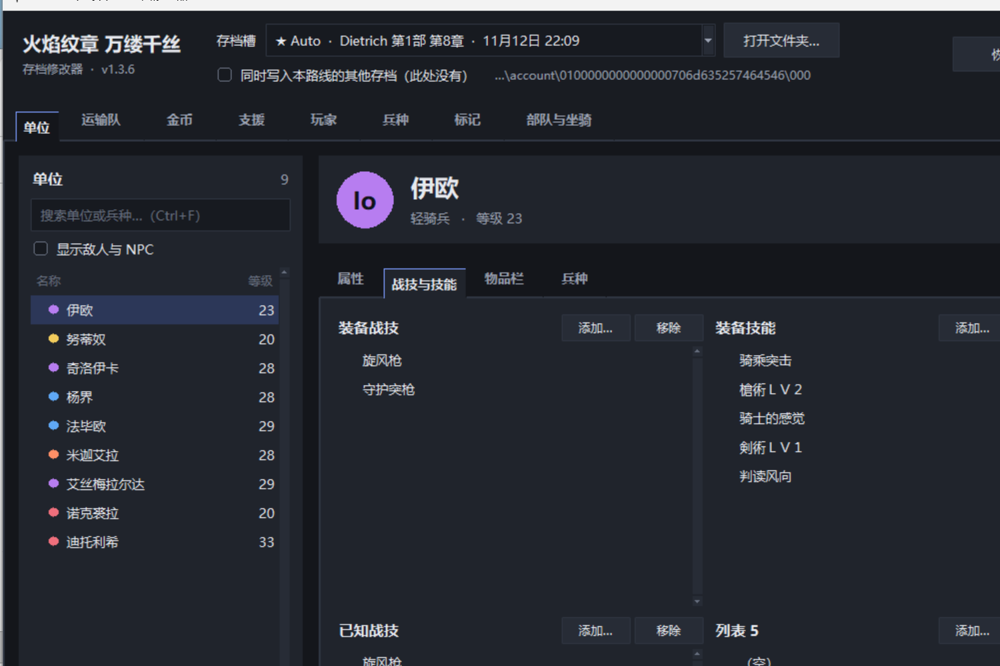
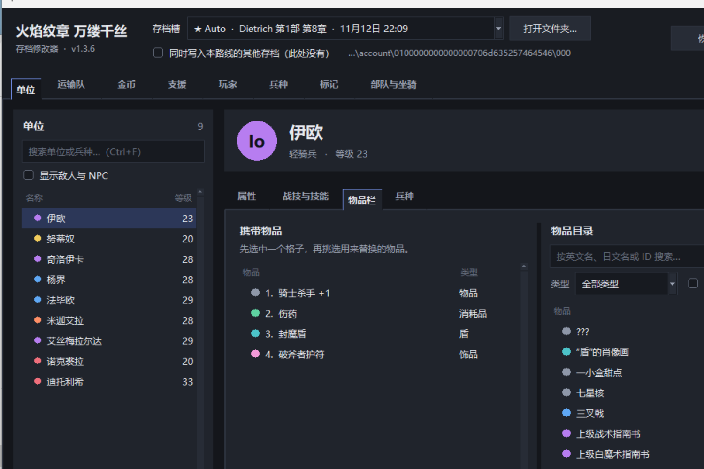
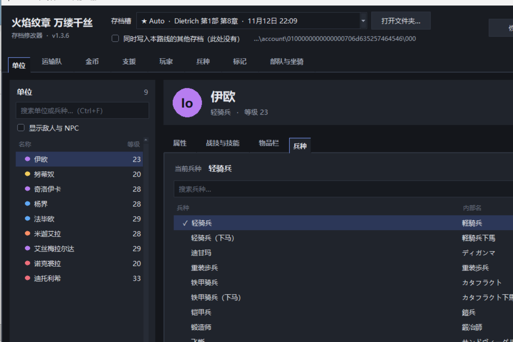

# 火焰纹章：万缕千丝 存档修改器 —— 简体中文版

> 上游 v1.3.6（英文界面）的**完整汉化版**：界面文案 + **物品 / 职业 / 技能 / 人名全部使用游戏官方简体中文**。
> 汉化只改「显示出来的文字」和名字表里的 `zh` 字段，**存档读写、指针重建、校验和、压缩帧逻辑一律未改**。



---

## 1. 怎么跑

| 方式 | 步骤 |
|---|---|
| 已打包 exe | 双击 `release-zh-cn\FEFW Save Editor 中文版.exe`（单文件，无需 Python） |
| 源码 | `pip install -r requirements.txt`，然后 `python editor.py`（Python 3.10+） |
| 指定存档 | `python editor.py "D:\...\save\account\<ID>\000"` |

**注意**：本机 `python` 若指向缺少 Tcl 库的运行时，会报 `Can't find a usable init.tcl`。这台机器上可用的是
`C:\Users\Admin\AppData\Local\Programs\Python\Python312\python.exe`（Tk 8.6 + zstandard 0.25.0）。

想临时回到英文界面：设环境变量 `FEFW_LANG=en` 再启动，补丁不会装，界面保持原样。

---

## 2. 官方中文名字从哪来（关键结论）

游戏本体就有简体中文，**中文名不在地图/存档里，而在 ROM 的消息表文件里**：

```
<romfs>\Msg\
    CNzh\   Item.msbt.zst  Job.msbt.zst  Person.msbt.zst  Skill.msbt.zst  Classchange.msbt.zst ...  (524 个文件)
    TWzh\   ── 同上 524 个（繁体）
    JPja\   ── 同上 524 个（日文）
    EUen\   ── 同上 524 个（英文）
    USen / EUde / EUes / EUfr / EUit / KRko / USes / USfr
```

- 12 个语言目录**每个恰好 524 个文件**，即同一套 label 集合——所以 `CNzh` 与 `JPja`、`EUen` 是**逐 label 对齐**的，
  不需要猜测对应关系，同一个 `MIID_IronBow` / `MJID_BowKnight` / `MPID_Ursula` / `MSID_HitAway` 在三种语言各有一条文本。
- 文件是 zstd 压缩的 `msbt`（任天堂消息表）。项目自带 `msbt.py` 即可解：
  `msbt.read(path) -> {label: text}`。
- 读出来的就是**官方译名**，实测量例：

| label | JPja | EUen | **CNzh** |
|---|---|---|---|
| `MIID_IronBow` | 鉄の弓 | Iron Bow | **铁弓** |
| `MJID_BowKnight` | ボウナイト | Bow Knight | **弓骑士** |
| `MPID_Ursula` | ウーシュラ | Ursula | **乌修拉** |
| `MSID_HitAway` | ヒット＆アウェイ | Attack, Get Back | **攻击&远离** |
| `MJID_HighEpitaph` | 高位墓碑 | High Epitaph | **高阶墓志铭** |
| `MSID_SeriousAttack` | 真剣な一撃 | Serious Attack | **认真的一击** |

本机的 dump 路径（来自 `D:\fefw-recomp-0.1.6\fefw.ini` 的 `[fs] romfs`）：

```
J:\火焰纹章-风花雪月-switch2\WLQS\room\romfs
```

> 目录名写的是"风花雪月"，但里面就是本作的 dump；`romfs\Msg\CNzh` 存在即证明中文可用。

### 2.1 生成脚本

```powershell
python build_zh_names.py "J:\火焰纹章-风花雪月-switch2\WLQS\room\romfs"
# 或者先 set FEFW_ROM，然后 python build_zh_names.py
```

它做三件事：

1. 用 `msbt.read()` 扫 `CNzh`（同时读 `JPja`、`EUen` 的对应 label）建三张表：
   `jp->zh` 58489 条、`en->zh` 57962 条、`by_label` 68110 条；跳过 `_H_` 开头的帮助文本（那不是名字）。
2. 按各表原有键（`MIID_` / `MJID_` / `MSID_` / `MPID_`）逐条回填 `zh`；
   职业的 `下馬/上馬` 变体用「基类中文 + （下马）」组合，并标 `zh_src="derived"` 区分派生名。
3. 支援表按角色日文名回填 `a_zh` / `b_zh`。

原始表在改动前备过份：`%TEMP%\fefw_names_bak\`（item / job / skill / unit / supports）。

### 2.2 覆盖率与「不是漏译」的证明

| 表 | 有中文 / 总数 | 说明 |
|---|---|---|
| 物品 `item_ids.json` | 1196 / 2908（41%） | 缺口 1712 条的英文名**在官方文本里一条都查不到**（见下） |
| 职业 `job_ids.json` | 132 / 342（39%） | 其余多是内部模板/怪物职业，游戏没给名字 |
| 技能 `skill_ids.json` | 739 / 2876（26%） | 缺口里绝大多数是 `SID_>` 分类头和内部条目 |
| 单位 `unit_ids.json` | 2846 / 3225（88%） | 缺口多是 `PID_SCXX_…` 剧情模板，官方文本里也没有名字 |
| 支援 `supports.json` | 238 / 238 组（100%） | 8 个可攻略角色 × 全部对象全中文 |

交叉验证（`diag_cov.py` 可复现）：把「表里有英文名但没中文」的条目拿去官方 `en->zh` 映射里查——

```
[物品] 无中文但有英文名 1712 条 → 英文名能在官方文本里找到 0 条
[技能] 无中文但有英文名    3 条 → 查到 0 条
```

也就是说：**凡是游戏自己写了名字的条目，全部拿到了官方中文；剩下的一律是游戏本身没给名字的切割内容/内部模板**，
它们的英文名是上游作者手写的 `HAND_NAMES`（如 `グラディウスの大剣`、`灰羽のお守り`、`魔砲台白`），不存在"官方译名"可查。

---

## 3. 汉化是怎么接进去的

两层：**界面文案层（`zh_cn.py` 打补丁）** 与 **名字数据层（JSON 的 `zh` 字段 + 显示取值优先中文）**。



**关键教训（第一版翻车的根因）**：只补 `Misc.configure` 时，构造期的 `text=` 全部漏译——891 条。
原因是 `Widget.__init__` → `BaseWidget._setup` → `tk.call(...)`，**根本不经过 `configure()`**。
所以补丁必须同时挂在 `tk.Widget.__init__`（构造）和 `tk.Misc.configure`（更新）两处。

**名字层的取值规则**：`zh or en or jp`（物品/技能还会重新拼 `+N` 强化后缀）。
英文、日文仍然保留在搜索 blob 里（`f"{zh} {en} {jp} {ID}"`），所以搜"Iron Sword"或"鉄の剣"一样能命中中文条目。

---

## 4. 译了什么，故意不译什么

| 类别 | 处理 | 原因 |
|---|---|---|
| 品牌名、页签、列名、按钮、长段说明、状态栏、弹窗 | **译** | 纯显示 |
| **物品 / 职业 / 技能 / 人名** | **官方简体中文**（来自 `Msg/CNzh`） | 游戏自己就有译名，硬译反而是臆造 |
| 无官方文本的条目（切割内容、章节副本、内部模板） | 保留原文（多是英文/日文） | 游戏没给名字，没有可查的官方译名；这些多为测试残留物品 |
| 物品类型（Sword/Axe…）、难度/模式 | 显示中文，逻辑仍用英文原值 | `item_kind()` / `KIND_COLORS` / JSON 键是英文；下拉框经 `kind_en()` 换回 |
| 标记名日文前缀（`面識_`/`加入_`/`支援会話_`…） | 前缀换成中文（已会面/已加入/支援对话…） | 底层 key 仍是日文，`friendly()` 只做显示；标记名本身游戏没有单独文本 |
| 存档槽文件名（`Auto`/`Chapter_Dit_1_1`…） | 保留 | 就是磁盘文件名 |
| 内部 ID（`MID_EV12_000_m01`、`JID_ローグ`、`SID_`/`PID` 哈希） | 保留 | 游戏内部标识，写回时要用 |

---

## 5. 改动的文件清单

| 文件 | 改动 |
|---|---|
| `build_zh_names.py` | **新增**：从 `Msg/CNzh` 生成/回填五张表的中文名（可重复运行） |
| `item_ids.json` `job_ids.json` `skill_ids.json` `unit_ids.json` | 每条新增 `zh`（职业另加 `zh_src`） |
| `supports.json` | 每组新增 `a_zh` / `b_zh` |
| `zh_cn.py` | **新增**：279 条词表 + 60 余条句式 + `install()`（补 Tk 显示出口） |
| `fefw_save.py` | `item_label()` / `job_name()` 中文优先；`UnitRecord` 增加 `zh` 槽与 `display` 属性 |
| `fefw_layer.py` | `skill_label()` 中文优先；`_BASE_SLOTS` 增加 `zh` |
| `editor.py` | 单位列表/详情、支援页角色与对象、物品目录排序与搜索、状态栏均走中文名；供给目录「有中文的排前面」 |
| `editor_advanced.py` | `class_label()` / `unit_name()` / 兵种页单位列表中文优先；添加技能、复制/移除单位提示用中文名 |
| `supports.py` | `by_char()` 记录带 `zh`；新增 `zh_of()`（日文名 → 中文名） |
| `editor_advanced.py` 常量 | `DIFFICULTIES=["普通","困难","疯狂"]`、`MODES=["休闲","经典"]` |

存档格式、指针重建、校验和代码一个字节都没动；`zh_cn.py` 与 `build_zh_names.py` 是纯新增，
备份原 JSON 即可回到纯英文名版本。

---

## 6. 验证（可复现）

| 验证 | 方法 | 结果 |
|---|---|---|
| 静态词表 | `check_keys.py` 逐字比对源码 | 279 条键里 273 条逐字命中，其余 6 条是运行时 `.upper()` 产物 |
| 运行时界面 | `ui_audit.py`：真实存档启动 GUI，泵事件到 `Auto` 载入，遍历所有控件/表头/行/下拉/标题，含单位页四个子页签 | **仍为英文的显示文本 0 条** |
| 逻辑功能 | `test_logic.py`：存档副本上真实读写 26 项 | **26 通过 / 0 失败** |
| 名字来源 | `diag_cov.py`：缺口条目回查官方 `en->zh` | 有英文名却无中文的「官方可查」条目 = **0** |
| 可视化 | `docs/*.png` 均为真机截屏 | 见下 |

> 审计口径说明：白名单只豁免「游戏本身没给文本」的条目（`item_ids.json` 等四张表里 `zh` 为空的名字），
> 有中文名的条目再出现英文就会被判为残留。第一版审计把「所有数据名」都豁免了，等于自我欺骗——
> 收紧后立刻暴露出 128 条真残留（单位页「兵种」子页签的职业列表、支援页里 12 个 NPC 对象名），已全部修掉。

关键回归项：金币 `9584009 → 1234567` 写入/落盘/重读/回读四处一致；难度按中文 `.index()` 写入 `(2,0,1)→(2,1,1)`；
物品筛选中文 `全部类型` 与英文 `All types` 结果完全等价（600==600）；支援表 `values[0]` 仍是日文数据键（未被污染）。

### 截图

| 页面 | 图 |
|---|---|
| 运输队（物品名 + 类型 + 物品目录） |  |
| 支援（角色列与支援对象全中文） |  |
| 兵种（当前兵种/拥有兵种） |  |
| 战技与技能 |  |
| 物品栏 |  |
| 单位页 →「兵种」子页签（含「（下马）」派生名） |  |

---

## 7. 已知边界（不谎报）

- **无官方文本的条目仍显示原文**：游戏没给名字的切割物品/内部职业/`SID_>` 分类头，没有"官方中文"可查，
  显示英文/日文是如实反映；搜索仍可按中文名找到已翻译的同类条目。
- **标记页的标记名**：`flag_names.json`（51586 条）的 label 多为日文内部名（如 `禁止_乗り物`），
  游戏没有为每条标记提供本地化文本，本次只把前缀换成中文（`禁止_乗り物` → `禁止_乗り物` 前缀"禁止"）。
- **动态弹窗只做了句式覆盖 + 逐条推演，没有逐条在 GUI 里点出来**；触发它们需要真实改档-保存-撤销循环。
- **繁体（TWzh）未启用**：`Msg/TWzh` 与 `CNzh` 结构完全相同，改 `build_zh_names.py` 的语言参数即可生成繁体表，
  但当前版本只交付简体。
- 上游 README 说明"编辑存档可能损坏存档"，汉化不改变这一性质；请自行备份。

---

## 8. 物品状态块与「放入的一定是全新道具」

### 8.1 存档里物品格的两种形态

| 记录 | 长度 | 含义 |
|---|---|---|
| `0x41` + `iid` | 5 字节 | **全新物品**：从未被消耗过，游戏按表内上限显示为满耐久 |
| `0x61` + `iid` + 8 字节 | 13 字节 | **消耗过的物品**：多出一个每份独立的状态块 |

8 字节状态块的含义（经游戏内实测确认）：

```
b0 b1  = 物品内部编号（运行时物品表的索引，不是耐久上限；布雷萨布利克 1358 而实际上限 20）
b2     = 已消耗量        ← 剩余耐久 = 表内上限 − b2
b3     = 是否装备（1 = 正占据它所属类别的装备位；同类只能一个，不同类可并存）
b4     = 语义未定（同为「圣疗」，法毕欧=2、杨界=1，说明它不是物品自身属性，勿改）
```

> 2026-11-14 内存实测更正：`b3` 原来被猜成"类别标记"，实际是**装备位**。
> 按内存逐格核对，`0x41`（5 字节记录）在内存里恒为 `b2=0, b3=0`，即"没消耗、没装备"——
> 这说明 `0x41` 不是"该物品没有耐久"，而是"这一格没有任何状态可写"的压缩形式。详见第 9 节。

### 8.2 实测对照（游戏画面 ↔ 存档字节）

| 游戏显示 | 记录 | b2 | 校验 |
|---|---|---|---|
| 安萨拉 **18/20** | `61 a9ff35ec 1b 00 02 00 01…` | 2 | 20 − 2 = 18 ✔ |
| 伤药 **1/3** | `61 bac907a6 81 02 02 00 01…` | 2 | 3 − 2 = 1 ✔ |
| 伤药 **2/3** | `61 bac907a6 81 02 01 00 01…` | 1 | 3 − 1 = 2 ✔ |
| 伤药 **3/3** | `41 bac907a6`（无状态块） | — | 全新 = 满 ✔ |
| 布雷萨布利克 **20/20** | `61 d7e7663c 4e 05 00 01 01…` | 0 | 满 ✔ |
| 布雷萨布利克 +3 **30/30** | `41 b4216d84` | — | 全新 = 满（同一家族上限 30）✔ |
| 邪剑维罗齐涅 +1 **30/30**、档案 B **1/1** | `41 …` | — | 全新 = 满 ✔ |
| 治愈之杖 / 魔毒骨锁 / 封魔盾（**无耐久列**） | `61 …` | 0 | 防具天生无耐久，该位无意义 |

**上限是逐物品的表内属性**，不是固定值：实测已见到 1、3、8、16、20、30 六种；
「强化」在存档层就是换成另一个 `iid`（布雷萨布利克 `d7e7663c` / +1 `b4216d86` / +2 `b4216d85` / +3 `b4216d84`），
不涉及状态块。

### 8.3 本次改动：替换物品 = 写入全新道具

`fefw_layer.py:set_item()` 原本把**旧格子的 8 字节原样抄给新物品**，于是新放入的物品会继承旧物品的消耗量；
一旦新物品上限更小就会越界（例：某格是消耗过的伤药 b2=2、上限 3，替换成上限 1 的档案 B → 1−2 = **−1**）。

现在改为**丢弃旧状态块**（`core.Item(id, b"", magic)`），即写入 `0x41` 五字节记录：

- 放入/替换的物品一律是全新（满耐久），不会带入任何消耗量，也不会产生越界值；
- 这是游戏本身就存在的正常形态（上表多件物品都是 `0x41`），不是伪造记录。

验证：`t_replace_fresh.py` 在存档副本上做了三种替换（伤药→档案B、安萨拉→铁斧、斩马刀+1→伤药），
重解析后物品数与顺序不变、全部落为 `0x41`；`test_logic.py` 回归 **26 通过 / 0 失败**。

### 8.4 「修满耐久」按钮（本次新增）

物品栏新增两个改动：

1. **列表直接标注消耗量**：有状态块的格子显示 `安萨拉　（已消耗耐久 2）`，全新的格子不加标注。
2. **「修满耐久」按钮**：选中一格 → 点它 → 该格重写为 `0x41`（全新），游戏里立刻回到满耐久。

不做「设成任意剩余值」是有意为之：**没人需要一把快坏的武器**，满耐久才是目标；
而且不知道逐物品上限就无法 clamp，猜上限会把能用的武器写成 0。**修满不需要知道上限，永远安全。**

实现（`fefw_layer.py`）：

```python
item_wear(payload, uid)                 # 每格已消耗量（0 = 满）
repair_item(payload, uid, index) -> bool  # 丢弃状态块 → 全新；格已全新/索引越界返回 False
```

验证：`t_repair.py` 对迪托利希/法毕欧/米迦艾拉/杨界四处消耗痕迹全部修满、物品数与顺序不变；
GUI 端到端 `t_repair_gui.py`（选中第 3 格 → `repair_wear()` → wear 2→0 → `save_all()` 落盘），
重复点击提示「已经是满耐久」而不是重复写入；`test_logic.py` 回归 **26 通过 / 0 失败**。

### 8.5 仍做不到的

- **还不能显示"当前/上限"**：上限在 `romfs\GameData\Item.bin` 的「耐久」字段里，尚未解析；
  因此列表只标注「已消耗 N」，不写 `18/20` 这种比值。
- **不能对防具写耐久**：防具（盾/饰品/杖类）没有耐久，其状态块 b2 恒 0，修满对它们没有意义（按钮会提示已是满耐久）。
- **不提供「设为任意值」**：见 8.4 的理由——不知道逐物品上限就无法 clamp，写错会把能用的武器变成 0 耐久。

---

## 9. 运行期内存结构（Cheat Engine 实证，2026-11-14）

这一节全部由**游戏运行中直接读取 `fefw.exe` 内存**得到（只读，未写入），不是推断。

### 9.1 每个单位一段固定 2224 字节

- 一个单位的"物品数组"是一段**定长 2224 字节（`0x8B0`）**的记录段，9 个单位**线性相连**；
- 段首开始每 8 字节一格，**物品区 = 段内偏移 `0x000`–`0x0EF`，共 30 格**；
- `0xF0`–`0xF3` 是 4 字节空隙，**`0xF4` 起是别的字段**（实测为 `00 00 80 3F` = float 1.0，属性/成长率一类）。
  9 个单位测得的最早非零偏移全部落在 `0xF4`（迪托利希 `0xF6`），因此 **30 格是所有单位一致的上限**；
- 段内物品是**从第 1 格连续填充**的，剩余格子恒为 `00 00 00 00 00 00 00 00`。所以"往空格写 0"等于空操作，安全。

内存顺序 **与存档顺序完全一致**（9 个单位逐格核对通过），不存在"显示顺序和内存顺序不同"的情况。

**30 格是怎么分出来的（2026-11-14 批量读档实证）**：界面把同一条数组拆成四栏显示，容量固定为

| 界面栏位 | 上限 |
|---|---|
| 持有物品 | **6** |
| 兵种专用攻击 | **12** |
| 攻击魔法 | **6** |
| 辅助魔法 | **6** |
| 合计 | **30** |

这条上限只在**读档填格时**起作用：写 30 件"持有物品"进存档，进游戏只剩前 6 件（其余 24 件被丢弃，第 1 批实测存活 6/30）；
改成 6 件持有 + 24 件魔法后，26、27、30 格都能整段存活。所以**内存数组本身没有 4 段之分**，
只是显示层按物品类型把同一串格子归到四栏；批量读编号时按 6+24 装载即可一次读满 30 格。
被游戏判定为占位条目的（`ExtraArms*`、`xxx_第3部_物攻_` 等）读档时不进内存，**留在原位变成空格**，
不会挤动后面的格子，因此"格位 ↔ 写入顺序"始终是 1:1。

### 9.2 本局实测的地址梯（重启会变）

```
迪托利希     0x1E45E33C        ← 段 0
艾丝梅拉尔达 0x1E45EBEC   +0x8B0
奇洛伊卡     0x1E45F49C   +0x8B0
法毕欧       0x1E45FD4C   +0x8B0
米迦艾拉     0x1E4605FC   +0x8B0
杨界         0x1E460EAC   +0x8B0
伊欧         0x1E46175C   +0x8B0
诺克裘拉     0x1E46200C   +0x8B0
努蒂奴       0x1E4628BC   +0x8B0
```

顺序 = 存档单位列表顺序。这是**堆地址**，重启游戏后整梯平移，脚本不能写死。

### 9.3 8 字节格的权威语义

| 字节 | 含义 | 证据 |
|---|---|---|
| `b0 b1` | 物品内部编号（u16 小端），如 27=安萨拉、641=伤药、1358=布雷萨布利克 | 与游戏内物品逐件对照 |
| `b2` | **已消耗量**，剩余 = 表内上限 − b2，0 = 满 | CE 改 10 → 游戏显示 10/20；改 0 → 回到 20/20 |
| `b3` | **是否装备**（1 = 占据所属类别的装备位） | 迪托利希斩马刀+1/猎人戒指=1；法毕欧四件=1（武器/杖/盾/饰品各一槽） |
| `b4` | 语义未定（1 或 2），**不要改** | 同为圣疗：法毕欧=2、杨界=1 |
| `b5..b7` | 恒 0 | 全部样本一致 |

**`0x41` 与内存的关系**（这是之前最容易误解的一点）：

> 存档里的 `0x41` / `0x61` 只是**记录长度标记**（5 字节 / 13 字节），内存里并不存在这两个字节。
> 内存恒为 8 字节，`0x41` 对应的形态是 `编号 00 00 b4 00 00 00`，即 **`b2=0` 且 `b3=0`**：
> "既没消耗、也没装备"。游戏只在有状态可写时才用 13 字节记录，这是**压缩**，不是"这件物品没有耐久"。

反过来也成立：任何一格只要 `b2=0 且 b3=0`，编辑器就可以把它压成 `0x41`，游戏读回来就是满耐久 + 未装备。
「修满耐久」按钮正是这么做的。注意 `65`（斩马刀 +1）的编号低字节恰好是 `0x41`、`97` 的低字节是 `0x61`，
所以按 `41`/`61` 搜内存会命中一堆物品编号，那是巧合，不是标记。

### 9.4 实测编号表与物品代码对照表

- `物品代码对照表.csv`（项目根，2908 行，UTF-8 BOM，可直接双击用 Excel 打开）：
  列 = `内部编号b0b1 / 编号依据 / 物品ID / 日文名 / 英文名 / 中文名`；
  **1379 条为内存实测**，1504 条无编号（重复条目 1496 + 游戏丢弃 33，其中 8 条 `ExtraArms05–08` 归入后者），没有一条是"猜"出来的。

**编号是怎么算出来的：编辑器不写它，游戏读档时自己算**

以「骑士杀手+1」（`333a251e`）替换进背包为例，`set_item()` 写进存档的**只有**：

```
0x41  33 3a 25 1e     ← tag + 4 字节 iid；存档里没有任何"编号"字段
```

所以编辑器**没有也不可能**有 `333a251e → 编号` 的对应关系，它不需要知道。
编号是**游戏读档时**拿 iid 查自己的物品表、把"第几条"填进内存格子的结果。
这正是"存档里搜不到 b0b1、只在内存里有"的原因，也意味着**编号可以由表顺序算出来，不必进游戏对位**。

**最终规律（2026-11-14，1379 条逐格实测，0 条例外）**：编号 = 该物品在 `item_ids.json` 的行号 + 分段常数。
`0x41`/`0x61` 只是记录长度，与编号无关。断点由实测夹出来：

| 行号 | 编号 | 依据 |
|---|---|---|
| 0 – 607 | = 行号 | 实测（含低区 520–607 全部扫描） |
| 608 – 609 | 无编号（游戏丢弃） | 两条怪物占位条目，读档即空 |
| **610 – 1351** | **= 行号 + 4** | 实测：行 610 → 编号 614，说明 4 个无名字条目占的是编号 610–613 |
| 1352 – 2847 | 无编号 | 重复/未使用条目，不在游戏编号空间 |
| 2848 – 2862 | = 行号 − 1491 | 实测（含布雷萨布利克家族） |
| 2863 – 2870 | 无编号（游戏丢弃） | `ExtraArms05–08` 占位条目 |
| 2871 – 2907 | = 行号 − 1499 | 实测（试作品系列） |

**实测是怎么来的（可复现）**：编辑器往**手动槽2**写一批物品（9 单位 × 6 持有 + 24 魔法 = 30 格），
游戏读该槽一次，脚本就用 `ReadProcessMemory` 读 9 段共 270 格，与写入顺序逐格对位；
7 批覆盖了 `0–1351` 与 `2848–2907` 的全部有名字条目，**不需要收集任何稀有道具**。

**已被排除的三条捷径**（不必重做）：物品 ID 这类 u32 在 12 GB 进程内存里 0 命中、在 `Item.bin` 里也 0 命中；
`1656 × 81` 字节记录里没有名字偏移，也没有名字偏移数组；运行时不存物品名字符串（`安萨拉`/`Vulnerary` 全 0 命中），
只经"编号 → 记录 → 消息标签"两跳解析。

早期人工核对的 49 条（编号 → 物品）：27 安萨拉、65 斩马刀+1、86 邪剑维罗齐涅+1、132 邪枪姆恩、
184 骑士杀手+1、195 辛萨的鱼叉+1、224 铁斧、235 战锤、237 邪斧维雷尔海特、238 邪斧干多迦、
268 达·米纳斧+1、358 达·米纳弓+1、387 亚革杰之弓+1、401 铁手甲、409 乾坤圈、416 大熊的右钩爪、
474 沙拉曼达+1、484 雷电、486 烈风、502 多拉Δ、503 史莱姆B、506 报丧Θ、509 死神Γ、
514 圣疗、515 圣愈、516 远程圣疗、519 圣吸、641 伤药、642 混合药、643 特效药、644 圣水、
670 重装术指南书、702 档案B、734 达·米纳盾、735 银盾、737 封魔盾、742 幻影戒指、743 猎人戒指、
747 噬毒宝珠、755 挑战宝珠、758 奇迹宝珠、762 破斧者护符、775 魔毒骨锁、780 魔道之杖、
782 治愈之杖、787 Graceful Gem、1357 冰冻救世之枪、1358 布雷萨布利克、1368 布雷萨布利克+3。


### 9.5 内存 ≠ 存档：运行中改档不会生效

2026-11-14 实测：内存里迪托利希的安萨拉 `b2=2`，而磁盘存档已被编辑器改成 `0`。

- 游戏运行时，**一切数据以内存为准**；编辑器改存档文件对已打开的存档没有任何影响；
- 游戏下一次存盘会把内存值（`b2=2`）写回文件，**覆盖**编辑器的修改；
- 所以「修满耐久」必须**先退出游戏 → 改档 → 再进游戏**，否则白改。

### 9.6 「无耐久消耗」脚本（CE 自动汇编，可选）

思路：不碰游戏代码，只用定时器把「已消耗量」压回 0。**0 在任何物品上都是合法值**，
最坏结果只是脚本没生效，不会写出越界值。特征码用米迦艾拉前 4 格（32 字节，1 个通配），
命中后减 `4 × 0x8B0` 回到段 0：

```
[ENABLE]
aobscanmodule(aobMich, fefw.exe, ED 00 00 01 01 00 00 00 0C 01 00 00 01 00 00 00 81 02 ?? 00 01 00 00 00)
alloc(baseptr, 8)
alloc(zeroloop, 0x200)
baseptr:
  dq 0
zeroloop:
  mov rax, aobMich
  sub rax, 0x22C0
  mov [baseptr], rax
loop:
  mov rbx, [baseptr]
  mov r8d, 9
seg:
  mov rsi, rbx
  mov ecx, 30
cell:
  cmp byte [rsi+02], 0
  je nxt
  mov byte [rsi+02], 0
nxt:
  add rsi, 8
  dec ecx
  jnz cell
  add rbx, 0x8B0
  dec r8d
  jnz seg
  sub rsp, 0x28
  mov ecx, 50
  call kernel32.Sleep
  add rsp, 0x28
  jmp loop
createthread(zeroloop)

[DISABLE]
dealloc(zeroloop)
dealloc(baseptr)
unregistersymbol(aobMich)
```

- `0x22C0 = 4 × 0x8B0`：从米迦艾拉回到段 0；
- 每 50 ms 扫 9 段 × 30 格 = 270 格，只对 `b2 ≠ 0` 的写 0；
- `sub rsp, 0x28` 是 x64 调 `Sleep` 的栈对齐，不能删；
- 已知局限：**特征码依赖米迦艾拉那 3 件物品**，如果你把邪斧/达·米纳斧+1/伤药换掉，扫描会失败。
  那时改用指针扫描（CE → Pointer scan），或换用别的单位当特征。

### 9.7 为什么不走"改写入指令"这条路

"找出是什么改写了这个地址 → NOP 掉"听起来更彻底，但：

- 写入耐久的那条指令很可能**与写 `b3`（装备）/`b4` 共用同一段代码**，NOP 之后装备状态会停止更新；
- 它也可能是**所有物品共用**的例程（武器、法术、消耗品都会减 `b2`），全局跳过会让"消耗品不减少"等行为一起消失；
- 收益是 0：`b2` 的语义已经完全确认，直接写 0 就能达到目的，不需要理解代码。

因此本项目的结论是：**内存侧只写 0，不改代码；文件侧只写 `0x41`，不改战斗逻辑。**
